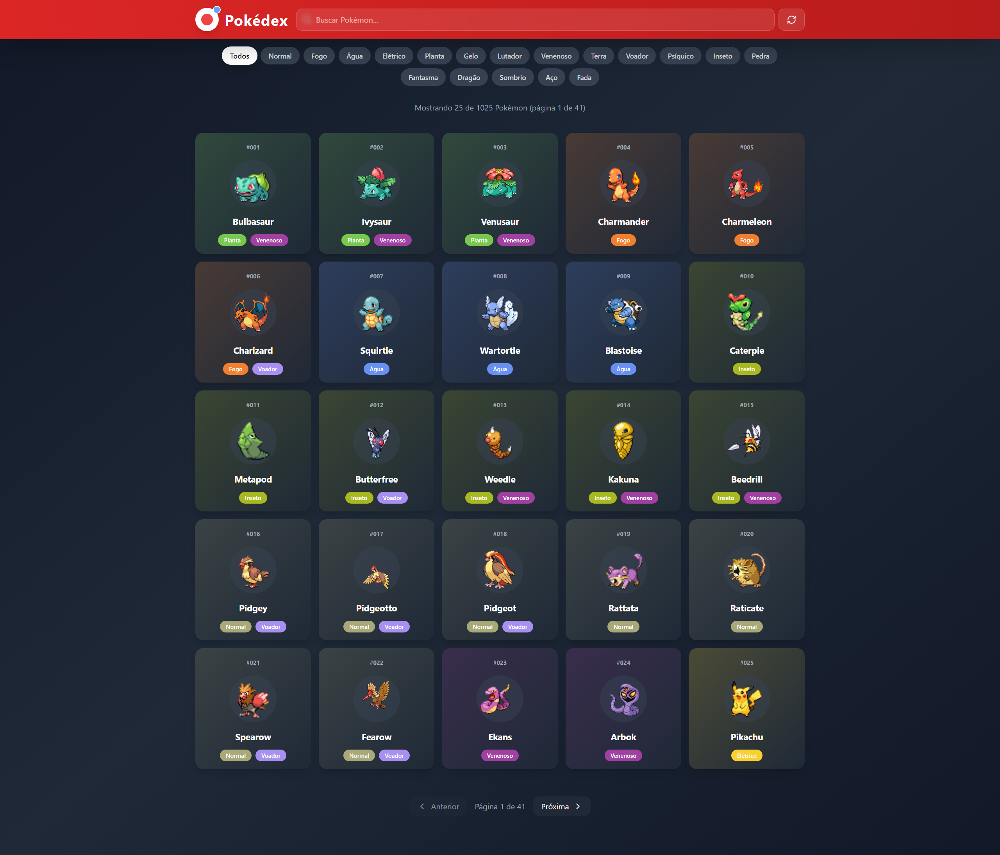

# Pokédex


## 🎯 Description

A modern Pokédex application built with React, TypeScript, Vite, and Tailwind CSS. Browse through all 1025 Pokémon with detailed stats, abilities, and beautiful card designs.

### ✨ Features

- 🎨 **Modern UI** - Dark theme with gradient cards and smooth animations
- 🔍 **Search** - Find Pokémon by name or number
- 🏷️ **Type Filter** - Filter Pokémon by their types (Fire, Water, Grass, etc.)
- 📊 **Detailed Stats** - View base stats with visual progress bars
- 📱 **Responsive** - Works on mobile, tablet, and desktop
- 🎭 **Animated Sprites** - Pokémon sprites with animations
- 📄 **Pagination** - Navigate through all generations

### 🛠️ Technologies

- **React 18** - UI library
- **TypeScript** - Type safety
- **Vite** - Fast build tool and dev server
- **Tailwind CSS** - Utility-first CSS framework
- **Lucide React** - Beautiful icons
- **PokeAPI** - Free and open Pokémon data API

## 🚀 Getting Started

### Prerequisites

- Node.js 18+ 
- npm or yarn

### Installation

```bash
# Install dependencies
npm install

# Start development server
npm run dev

# Build for production
npm run build

# Preview production build
npm run preview
```

The app will be available at `http://localhost:5173`

## 📸 Screenshots



The application features:
- A red header with search bar and refresh button
- Type filter buttons for all 18 Pokémon types
- Responsive grid of Pokémon cards with gradient backgrounds
- Detailed modal with stats, abilities, and info

## 🎨 Type Colors

All 18 types have unique gradient colors matching the Pokémon games aesthetic.

## 📝 License

MIT License
